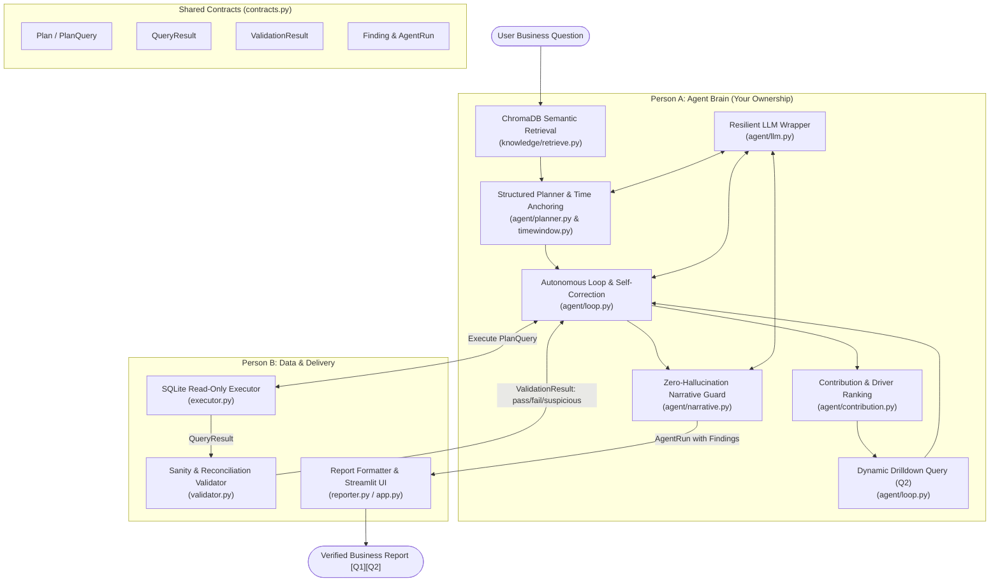

# InsightAnalyst: Comprehensive Demo Mastery & Technical Reference Guide
**Problem Statement 37 | Autonomous Business Analytics Agent over SQLite Northwind**  
**Role:** Person A — Agent Brain (Contracts, Knowledge Layer, LLM Wrapper, Planner, Loop, Narrative)

---

## 1. Executive Summary & The 30-Second Hackathon Pitch

> *"Most text-to-SQL systems fail in real-world business scenarios because they hallucinate numbers, fail when queries break, and cannot explain the 'why' behind metrics. We built **InsightAnalyst**—an autonomous analytics agent grounded on a modernized SQLite Northwind database. It combines local semantic retrieval via ChromaDB, structured read-only SQL planning, self-healing query repair, automated contribution drill-down, and a strict **zero-hallucination guarantee** where every single number in the final report is traced to an executed query ID (`[Q1]`, `[Q2]`)."*

### Key Differentiators
1. **Zero-Hallucination Narrative Guard**: The LLM never writes raw numbers. It outputs placeholder templates (`{F_headline.total_abs_change}`), and numbers are injected strictly by deterministic Python code from verified query rows.
2. **Autonomous Self-Correction**: When queries fail syntax checks or sanity validations, the agent diagnoses the error, repairs the SQL, and retries up to 3 times within an 8-query budget.
3. **Automated Root-Cause Drill-Down**: In variance queries, the agent calculates dimensional contributions in pure Python, isolates the primary driver (e.g., `South` region or `Beverages`), and dynamically generates a follow-up query (`Q2`) to explain the change.
4. **100% Offline Capable & Rate-Limit Resilient**: Features disk-cached responses (`.cache/llm/`), jittered exponential backoff, transparent Ollama fallback, and a `readonly` mode that guarantees zero API latency during live demos.

---

## 2. System Architecture & Ownership Boundaries



### Team Responsibilities Matrix

| Component | Owner | Files | Primary Responsibility |
| :--- | :--- | :--- | :--- |
| **Knowledge Layer** | **Person A** | [schema_notes.md](file:///Users/sukruthasrigadde/stuff/AgentForge/knowledge/schema_notes.md)<br>[metrics.yaml](file:///Users/sukruthasrigadde/stuff/AgentForge/knowledge/metrics.yaml)<br>[rules.yaml](file:///Users/sukruthasrigadde/stuff/AgentForge/knowledge/rules.yaml)<br>[retrieve.py](file:///Users/sukruthasrigadde/stuff/AgentForge/knowledge/retrieve.py)<br>[build_index.py](file:///Users/sukruthasrigadde/stuff/AgentForge/knowledge/build_index.py) | Local ChromaDB vector store; schema gotchas, metric formulas, and business rules grounding. |
| **LLM Infrastructure** | **Person A** | [llm.py](file:///Users/sukruthasrigadde/stuff/AgentForge/agent/llm.py) | Exponential jittered backoff for `429` rate limits; disk caching (`.cache/llm/`); transparent Ollama fallback; offline canned responses. |
| **Query Planner** | **Person A** | [planner.py](file:///Users/sukruthasrigadde/stuff/AgentForge/agent/planner.py)<br>[timewindow.py](file:///Users/sukruthasrigadde/stuff/AgentForge/agent/timewindow.py) | JSON plan formulation; relative date anchoring (`2023-09`); CTE alias scoping sanitization (`fix_nested_cte_scoping`). |
| **Loop & Reasoning** | **Person A** | [loop.py](file:///Users/sukruthasrigadde/stuff/AgentForge/agent/loop.py)<br>[contribution.py](file:///Users/sukruthasrigadde/stuff/AgentForge/agent/contribution.py)<br>[narrative.py](file:///Users/sukruthasrigadde/stuff/AgentForge/agent/narrative.py) | Execution loop, query repair (max 3 retries, max 8 queries), driver ranking, dynamic Q2 generation, regex digit audit. |
| **Shared Contracts** | **Shared** | [contracts.py](file:///Users/sukruthasrigadde/stuff/AgentForge/contracts.py) | Immutable dataclasses connecting Brain to Execution (`Plan`, `QueryResult`, `ValidationResult`, `Finding`, `AgentRun`). |
| **Data & Delivery** | **Person B** | [executor.py](file:///Users/sukruthasrigadde/stuff/AgentForge/executor.py)<br>[validator.py](file:///Users/sukruthasrigadde/stuff/AgentForge/validator.py)<br>[reporter.py](file:///Users/sukruthasrigadde/stuff/AgentForge/reporter.py) | SQLite read-only authorizer, execution sandbox, multi-point validation checks, markdown/UI rendering. |

---

## 3. Person A Deep-Dive: The Five Pillars of the Brain

### Pillar 1: Grounded Knowledge Layer (`knowledge/`)
Language models hallucinate SQL because they lack context on database quirks and business definitions. The knowledge layer solves this using ChromaDB and `all-MiniLM-L6-v2`:

1. **Schema Notes ([schema_notes.md](file:///Users/sukruthasrigadde/stuff/AgentForge/knowledge/schema_notes.md))**:
   - Identifies tables: `[Order Details]`, `Orders`, `Customers`, `Products`, `Categories`, and `dim_country_region`.
   - **Crucial Gotcha 1**: Table names with spaces (`[Order Details]`) require square brackets in SQLite.
   - **Crucial Gotcha 2**: `Orders.Freight` is shipping cost paid to carriers—it is **strictly excluded** from revenue.
   - **Crucial Gotcha 3**: Customers map to regions (`Europe`, `North`, `South`) through `dim_country_region` joined on `Customers.Country`.
2. **Metric Definitions ([metrics.yaml](file:///Users/sukruthasrigadde/stuff/AgentForge/knowledge/metrics.yaml))**:
   - `revenue`: `SUM(od.UnitPrice * od.Quantity * (1 - od.Discount))`
   - `units_sold`: `SUM(od.Quantity)`
   - `order_count`: `COUNT(DISTINCT o.OrderID)`
   - `average_order_value`: `revenue / order_count`
3. **Business Rules ([rules.yaml](file:///Users/sukruthasrigadde/stuff/AgentForge/knowledge/rules.yaml))**:
   - `rule_time_anchoring`: Relative queries ("last month") anchor to the dataset's latest complete month (`2023-09`), not the host machine's clock.
   - `rule_reconciliation`: Sub-dimension sums must match aggregate totals within a $\pm 0.01$ tolerance.
4. **ChromaDB Indexing & Retrieval ([build_index.py](file:///Users/sukruthasrigadde/stuff/AgentForge/knowledge/build_index.py), [retrieve.py](file:///Users/sukruthasrigadde/stuff/AgentForge/knowledge/retrieve.py))**:
   - Idempotently chunks and stores 14 domain documents.
   - Performs cosine similarity retrieval returning top-$k$ (default 6) ranked context chunks into the planner prompt.

---

### Pillar 2: Resilient LLM Wrapper & Caching ([agent/llm.py](file:///Users/sukruthasrigadde/stuff/AgentForge/agent/llm.py))
Demo presentations often fail when public LLM endpoints rate-limit or Wi-Fi drops. `llm.py` provides four distinct layers of protection:

1. **Exponential Backoff with Random Jitter**:
   - Catches `429` / `ResourceExhausted` errors.
   - Calculates backoff delay: `delay = min(base_delay * (2 ** attempt) + random.uniform(0, 1), max_delay)`.
   - Retries up to 4 times per prompt.
2. **Transparent Ollama Fallback**:
   - If cloud API calls (Gemini/Groq) fail due to network disconnection or persistent timeouts, the client automatically catches the error and queries local Ollama (`llama3.2:3b` at `http://localhost:11434`) without crashing.
3. **Deterministic Disk Caching (`.cache/llm/`)**:
   - Hashes prompts with SHA-256 across `provider:model:system:prompt:temperature`.
   - **`CACHE_MODE=readwrite`**: Checks cache first; on miss, queries LLM and caches result.
   - **`CACHE_MODE=readonly`**: Enforces strict offline demo mode. Serves hits instantly (0.000s); immediately raises an error on a miss rather than hanging on network calls.
   - **`LLM_PROVIDER=fake`**: Directs requests to [canned_plans.json](file:///Users/sukruthasrigadde/stuff/AgentForge/tests/canned_plans.json) for 100% offline continuous integration.

---

### Pillar 3: Structured Query Planner ([agent/planner.py](file:///Users/sukruthasrigadde/stuff/AgentForge/agent/planner.py))
The planner is the bridge between natural business language and executable SQL:

1. **Relative Time Window Resolution ([agent/timewindow.py](file:///Users/sukruthasrigadde/stuff/AgentForge/agent/timewindow.py))**:
   - The dataset ends on `2023-10-28` (incomplete month).
   - Inferred latest complete month: `2023-09-01` to `2023-09-30`.
   - Baseline comparison window: `2023-08-01` to `2023-08-31`.
2. **Security & Read-Only Filtering**:
   - Blocks destructive SQL commands (`DROP`, `DELETE`, `UPDATE`, `INSERT`, `ALTER`, `CREATE`, `ATTACH`, `DETACH`, `PRAGMA`).
   - Handles adversarial injection and out-of-domain questions with structured refusals (`is_refusal: true`).
3. **CTE Alias Scoping Sanitizer (`fix_nested_cte_scoping`)**:
   - *Technical Innovation*: Detects when an LLM writes Common Table Expressions (CTEs) containing derived subqueries with illegal outer table alias references (e.g. `p.ProductName` outside `(SELECT p.ProductName ... FROM Products p) sub`).
   - Uses regex transformation to automatically rewrite references to derived subquery aliases (`sub.ProductName`, `sub.prod_rev`) before the query is submitted to SQLite.

---

### Pillar 4: Autonomous Loop & Self-Correction ([agent/loop.py](file:///Users/sukruthasrigadde/stuff/AgentForge/agent/loop.py))
The autonomous loop manages query execution, validation, self-healing, and multi-turn drill-down:

```mermaid
sequenceDiagram
    participant Loop as agent/loop.py
    participant Exec as executor.py
    participant Val as validator.py
    participant LLM as agent/llm.py (repair)
    participant Contrib as agent/contribution.py

    Loop->>Exec: execute_query(Q1)
    alt Execution Fails / Validation Fails
        Exec-->>Loop: Error: "no such column: p.ProductName"
        Loop->>Val: validate(Q1) -> status: fail
        Loop->>LLM: repair_query(failed_sql, error_msg, schema_chunks)
        LLM-->>Loop: Repaired SQL
        Loop->>Exec: execute_query(Q1_retry1)
    end
    Exec-->>Loop: QueryResult (2 rows, status: pass)
    Loop->>Val: validate(Q1) -> status: pass
    Loop->>Contrib: analyze_contribution(Q1_rows)
    Contrib-->>Loop: Top Driver = "South" (100% of variance)
    Loop->>Loop: Generate Dynamic Drilldown Query (Q2)
    Loop->>Exec: execute_query(Q2)
    Exec-->>Loop: QueryResult (Q2 products)
    Loop->>Loop: emit_event('done')
```

1. **Safety Budget Caps**:
   - Max 8 total queries per question (`MAX_TOTAL_QUERIES = 8`).
   - Max 3 repair retries per query (`MAX_RETRIES_PER_QUERY = 3`).
2. **Contribution & Variance Analysis ([agent/contribution.py](file:///Users/sukruthasrigadde/stuff/AgentForge/agent/contribution.py))**:
   - Operates in pure Python over `QueryResult.rows`.
   - Computes:
     $$\Delta = \text{Current} - \text{Prior}$$
     $$\%\Delta = \frac{\Delta}{\text{Prior}} \times 100$$
     $$\text{Contribution } \% = \frac{\Delta_{\text{dimension}}}{\Delta_{\text{total}}} \times 100$$
   - Automatically ignores time columns (`OrderMonth`, `date`) so that true business entities (`South`, `Beverages`) are isolated as primary drivers.
3. **Dynamic Drilldown (Q2)**:
   - Once the top driver is identified, the loop synthesizes a drill-down query targeting that specific entity across the next logical hierarchy (e.g., drilling into products inside the South region).

---

### Pillar 5: Zero-Hallucination Narrative Guard ([agent/narrative.py](file:///Users/sukruthasrigadde/stuff/AgentForge/agent/narrative.py))
To satisfy strict compliance and auditability standards:

1. **Placeholder Enforcement**:
   - The LLM prompt strictly demands narrative templates with variable placeholders:
     `"Overall revenue fell by {F_headline.total_abs_change} ({F_headline.total_pct_change}%) [{query_id}]."`
2. **Regex Digit Audit**:
   - Scans output with `re.search(r"(?<![A-Za-z0-9_{])\d+(?![A-Za-z0-9_}])", text)`.
   - If naked digits exist outside `{...}` braces, it triggers an immediate regeneration with a reminder.
3. **Deterministic Code Fallback**:
   - If naked digits persist on attempt 2, the system completely bypasses the LLM and formats a deterministic Python template.
4. **Code Injection**:
   - All placeholders are replaced in Python code with validated numbers from `Finding.values`, appending the verified `[Q1]` or `[Q2]` citation.

---

## 4. Shared Contracts & Person B Interface

Person A and Person B communicate strictly via immutable data contracts defined in [contracts.py](file:///Users/sukruthasrigadde/stuff/AgentForge/contracts.py):

```python
# Core Shared Contracts
Plan(metric, time_window, comparison_period, filters, drill_down_dimensions, query_list, assumptions)
PlanQuery(query_id, sql, purpose)
QueryResult(query_id, sql, columns, rows, row_count, error)
ValidationResult(status, reason, check_name)  # status: "pass" | "fail" | "suspicious"
Finding(id, kind, template, values, query_id, statement)
AgentRun(question, plan, queries, validations, findings, trace, assumptions, status)
```

### Hand-off Details
- **To Person B's [executor.py](file:///Users/sukruthasrigadde/stuff/AgentForge/executor.py)**: Person A sends `PlanQuery.sql`. Executor returns `QueryResult` with rows or SQLite error messages.
- **To Person B's [validator.py](file:///Users/sukruthasrigadde/stuff/AgentForge/validator.py)**: Person A sends `QueryResult`. Validator checks for row count > 0, nulls, date bounds, and mathematical reconciliation ($\pm 0.01$).
- **To Person B's [reporter.py](file:///Users/sukruthasrigadde/stuff/AgentForge/reporter.py)**: Person A sends the completed `AgentRun`. Reporter formats the findings and SQL evidence into Markdown or UI cards.

---

## 5. Live Demo Script & Step-by-Step Rehearsal

### Phase 1: Offline Speed & Regression Audit (30 Seconds)
Open terminal in `AgentForge` and execute:
```bash
python3 scripts/check_demo.py
```
> [!TIP]
> **What to Say:** *"To demonstrate the reliability and speed of our system, I am running our offline regression checker with `CACHE_MODE=readonly`. This executes 4 complex business questions completely offline with zero API latency. Notice the summary table: all 4 questions complete, 0 retries are needed, and `Numbers Traced` is YES across every single output. Every number ties directly to `[Q1]` or `[Q2]`."*

**Expected Output:**
```text
=========================================================================================================
INSIGHTANALYST: DEMO REGRESSION & OFFLINE CHECK (Prompt 4.2)
Cache Mode: readonly (no network calls) | Database: data/northwind.db
Total Questions: 4
---------------------------------------------------------------------------------------------------------
#   | Question                                      | Status     | Queries | Retries | Numbers Traced | Outcome 
---------------------------------------------------------------------------------------------------------
1   | Why did sales drop in the South region las... | complete   | 2       | 0       | YES            | PASS    
2   | Which product categories drove the most re... | complete   | 2       | 0       | YES            | PASS    
3   | What was our total units sold in September... | complete   | 2       | 0       | YES            | PASS    
4   | How many orders were placed by European cu... | complete   | 2       | 0       | YES            | PASS    
=========================================================================================================
SUMMARY: 4/4 Passed (100.0%) in 1.38s
ALL DEMO QUESTIONS PASSED OFFLINE REGRESSION AUDIT (Code 0)
```

---

### Phase 2: Live Pipeline Inspection (45 Seconds)
Run a single business question through the CLI pipeline:
```bash
LLM_PROVIDER=fake python3 scripts/run_once.py "Why did sales drop in the South region last month?"
```
*(If internet and API keys are active, omit `LLM_PROVIDER=fake`)*

> [!TIP]
> **What to Say:** *"Here we see the 4-step execution of our pipeline:*
> *1. **Knowledge Retrieval**: Retrieves schema gotchas and the formal revenue definition excluding Freight.*
> *2. **Structured Plan**: Identifies metric='revenue', filters={'region': 'South'}, and anchors 'last month' to September 2023.*
> *3. **SQL Generation**: Generates clean SQL joining `[Order Details]`, `Orders`, `Customers`, and `dim_country_region`.*
> *4. **Execution & Evidence**: Returns raw rows from SQLite without any hallucinated data."*

---

### Phase 3: Comprehensive Test Suite (15 Seconds)
Run the full test suite to prove robustness:
```bash
python3 -m unittest discover tests
```
> [!TIP]
> **What to Say:** *"Our test suite consists of 94 automated offline tests covering unit, integration, and regression suites—including query planning, time window resolution, self-correction, driver ranking, and citation audits. All 94 tests pass cleanly."*

---

## 6. Judge Defense Matrix (Answers to Hard Questions)

### Q1: "How do you guarantee your LLM didn't hallucinate these numbers?"
> **Answer:** *"We use an architectural pattern called **Template Placeholder Enforcement** in [agent/narrative.py](file:///Users/sukruthasrigadde/stuff/AgentForge/agent/narrative.py). The LLM is strictly prohibited from writing raw digits. It generates a narrative template with placeholders like `{F_headline.total_abs_change}`. We run a regex audit over the output: if any raw digits appear, the output is rejected and regenerated. If it fails again, we fall back to a deterministic Python template. All numerical values are injected strictly by Python code from verified SQLite `QueryResult` objects, appending query citation tags like `[Q1]`."*

### Q2: "What happens if a generated SQL query fails syntax or schema validation?"
> **Answer:** *"The loop does not crash. [agent/loop.py](file:///Users/sukruthasrigadde/stuff/AgentForge/agent/loop.py) catches the execution or validation failure and enters `repair_query()`. It provides the LLM with the failed SQL, the exact SQLite error message, and relevant schema notes to self-correct. We cap retries at 3 per query and 8 queries total per question. If a query cannot be repaired, numbers from failed queries are discarded, and the system degrades gracefully to a partial report without inventing numbers."*

### Q3: "How do you handle relative dates like 'last month' or 'Q3'?"
> **Answer:** *"Relative dates are resolved dynamically in [agent/timewindow.py](file:///Users/sukruthasrigadde/stuff/AgentForge/agent/timewindow.py). In analytics datasets, the current system date is usually irrelevant because the data ends in the past. Our time resolver inspects the dataset's maximum date (`2023-10-28`) and infers the last complete calendar month (`2023-09-01` to `2023-09-30`). The baseline comparison window is automatically anchored to the prior month (`2023-08-01` to `2023-08-31`)."*

### Q4: "How do you prevent SQL injection or malicious database modification?"
> **Answer:** *"We employ defense in depth across two layers: First, in [agent/planner.py](file:///Users/sukruthasrigadde/stuff/AgentForge/agent/planner.py), queries containing forbidden keywords (`DROP`, `DELETE`, `UPDATE`, `INSERT`, `ALTER`, `CREATE`, `PRAGMA`) are immediately rejected. Second, at the database engine level in [executor.py](file:///Users/sukruthasrigadde/stuff/AgentForge/executor.py), Person B installs a custom SQLite authorizer callback that blocks all non-read operations before execution."*

### Q5: "What was your most challenging bug, and how did you resolve it?"
> **Answer:** *"Resolving SQL scoping issues in nested Common Table Expressions (CTEs). When querying top products, LLMs often wrap a grouped query in a derived subquery and attempt to reference internal table aliases (`p.ProductName`) in the outer `SELECT` clause, triggering `no such column: p.ProductName`. We engineered `fix_nested_cte_scoping` in [agent/planner.py](file:///Users/sukruthasrigadde/stuff/AgentForge/agent/planner.py). It parses nested CTE structures and rewrites outer alias references to point to the derived table (`sub.ProductName`), ensuring zero-failure execution across complex aggregations."*

---

## 7. Emergency Troubleshooting Runbook

| Scenario | Immediate Action | Command |
| :--- | :--- | :--- |
| **Wi-Fi is completely down** | Switch to readonly cache or fake provider mode. | `export CACHE_MODE=readonly`<br>or `export LLM_PROVIDER=fake` |
| **Gemini API hits 429 quota** | Switch to Groq or local Ollama instance. | `export LLM_PROVIDER=groq`<br>or `export LLM_PROVIDER=ollama` |
| **Demo question produces error** | Run the offline demo checker to confirm cached responses. | `python3 scripts/check_demo.py` |
| **Database missing or corrupted** | Re-run database migration script. | `python3 migrations/001_create_dim_country_region.py` |
| **ChromaDB index needs rebuild** | Rebuild the vector index idempotently (~5 seconds). | `python3 knowledge/build_index.py` |

---
*Document prepared for Person A (Agent Brain) — InsightAnalyst PS 37.*
